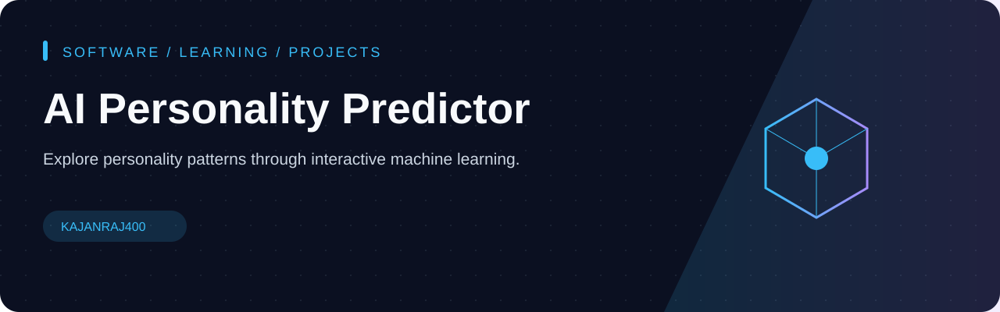
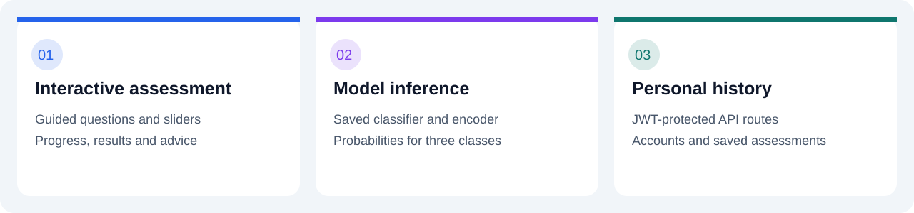
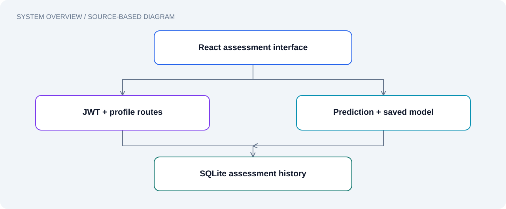

# AI Personality Predictor

**Explore personality patterns through an interactive assessment.**

[Features](#features) · [Quick start](#quick-start) · [Architecture](#architecture) · [API](#api-reference)

---

A full-stack academic application that turns questionnaire responses into **Introvert**, **Extrovert**, or **Ambivert** predictions. React provides the assessment experience, Flask serves the API, and a saved machine learning model generates predictions.

## Features

| Experience | Implementation |
| --- | --- |
| Guided assessment | Step-by-step questions, sliders and progress indicators |
| Account access | Signup, login and JWT-protected API routes |
| Prediction results | Predicted class, model probabilities and descriptive advice |
| Personal dashboard | Previous assessments and individual result pages |
| Profile management | View and update account details |
| Interface | Tailwind CSS and Framer Motion |

## Quick start

Clone the repository:

~~~bash
git clone https://github.com/kajanraj400/FDM.git
cd FDM
~~~

### 1. Start the backend

Use a Python environment compatible with the pinned dependencies in [requirements.txt](requirements.txt). Python 3.11 is a practical starting point; installation has not been verified as part of this documentation update.

~~~powershell
python -m venv .venv
.\.venv\Scripts\Activate.ps1
python -m pip install -r requirements.txt
python app.py
~~~

On macOS/Linux, activate with `source .venv/bin/activate`.

Keep this terminal open. The Flask development API listens at **http://localhost:5000**. Run from the repository root so that the model and feature files can be found.

### 2. Start the frontend

Open a second terminal with Node.js and npm installed:

~~~bash
cd FDM/frontend-react
npm ci
npm start
~~~

Open **http://localhost:3000**, create an account, complete the assessment and explore the results. The frontend development proxy forwards API requests to port 5000.

### 3. Build the frontend

~~~bash
cd frontend-react
npm run build
~~~

This creates the React production build. Backend deployment and serving that build require separate configuration.

## Architecture

| Layer | Responsibility | Location |
| --- | --- | --- |
| React frontend | Assessment, authentication views, dashboard and results | [frontend-react/src](frontend-react/src) |
| Flask API | Authentication, prediction, profiles and history | [app.py](app.py) |
| Feature definition | Ordered model input names | [features.json](features.json) |
| Model artifacts | Saved classifier and label encoder | [joblib](joblib) |
| SQLite | Accounts and saved assessment records | `instance/personality_app.db` |
| Training example | Synthetic-data Gaussian Naive Bayes retraining script | [retrain_model.py](retrain_model.py) |

The assessment sends numeric responses to `/api/predict`. The API orders them using `features.json`, runs the classifier, decodes the predicted label, stores the result and returns probabilities plus advice.

## API reference

Protected routes require `Authorization: Bearer <token>`.

| Method | Endpoint | Purpose | Authentication |
| --- | --- | --- | --- |
| POST | `/api/auth/signup` | Create an account | Public |
| POST | `/api/auth/login` | Get an access token | Public |
| GET | `/api/auth/verify` | Verify token and retrieve user | Required |
| GET / PUT | `/api/auth/profile` | Read or update profile | Required |
| GET | `/api/features` | Retrieve ordered input names | Public |
| POST | `/api/predict` | Predict and save an assessment | Required |
| GET | `/api/history` | Retrieve assessment history | Required |
| GET | `/api/test/<test_id>` | Retrieve one owned assessment | Required |
| GET | `/api/test-auth` | Authentication diagnostic | Required |

## Model context

The included retraining script generates **1,000 synthetic samples**, assigns labels using hand-written feature rules, and fits a **Gaussian Naive Bayes** classifier with an 80/20 train/test split.

That script describes a demonstration training workflow; it does not establish the provenance or real-world accuracy of the committed model artifacts. Model probabilities are not evidence of a clinically validated personality assessment.

Running `python retrain_model.py` overwrites the saved model and encoder in `joblib/`. Keep a copy of any artifacts you need before retraining.

## Troubleshooting

| Symptom | Check |
| --- | --- |
| Frontend cannot reach API | Start Flask on port 5000 and React on port 3000 |
| Model or feature file missing | Run `python app.py` from the repository root |
| Python installation error | Check compatibility with the pinned package versions |
| Model deserialization error | Check the model's training environment before replacing artifacts |
| Empty account history | Complete an assessment using the same signed-in account |

## Development status

This repository currently uses development settings, including placeholder signing keys, unrestricted CORS and Flask debug mode. Review these settings before deployment. No live demo, verified accuracy, automated test status or license is claimed here.

## Contributing

See [CONTRIBUTING.md](CONTRIBUTING.md) for a small, reviewable contribution workflow.

---

Built with React · Flask · scikit-learn

## Documentation

[Visual guide](docs/README.md) · [Roadmap](docs/ROADMAP.md) · [Citation](CITATION.cff) · [Licensing](docs/LICENSING.md)
